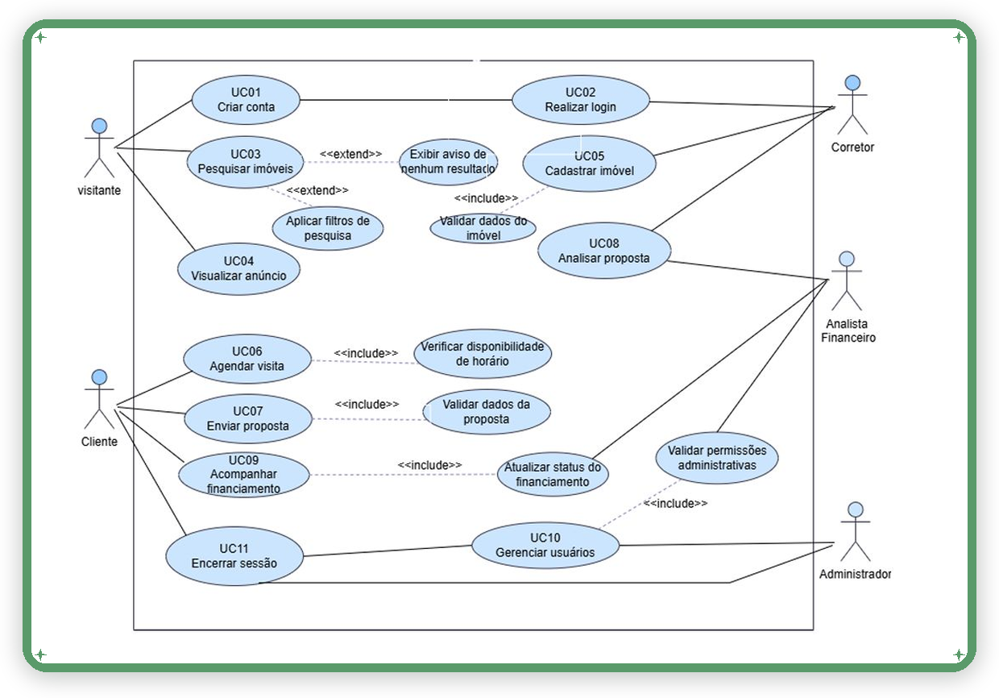
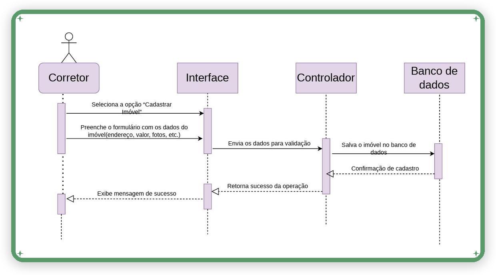
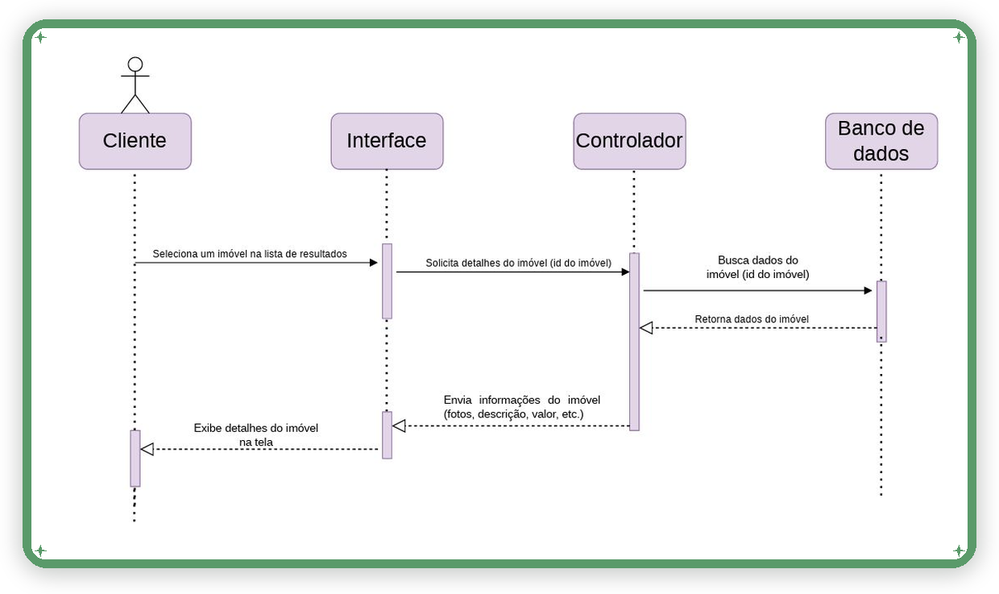
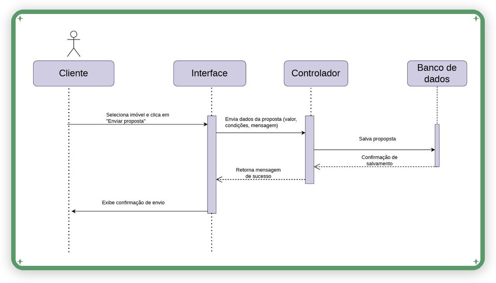
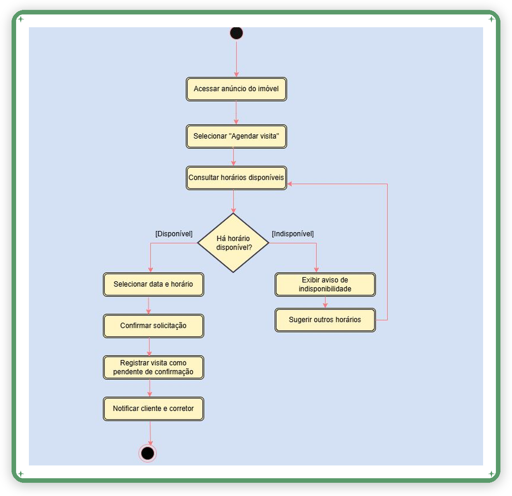

  

  
  
  
  

  <b>Documentação de Requisitos e Especificação do Sistema</b> 
  Disciplina de Gerência de Configuração · Docente: Walter Viana    

## 👥 Equipe

  <b>Letícia Abreu</b> &nbsp;·&nbsp; <b>Luís Gustavo</b> &nbsp;·&nbsp; <b>Paolla Gabriele</b>

## 📑 Sumário

1. [Introdução](#1-introdução)
   - 1.1. [Descrição Geral do Software](#11-descrição-geral-do-software)
   - 1.2. [Descrição dos Usuários](#12-descrição-dos-usuários)
2. [Requisitos Gerais do Software](#2-requisitos-gerais-do-software)
   - 2.1. [Requisitos Funcionais](#21-requisitos-funcionais)
   - 2.2. [Requisitos Não Funcionais](#22-requisitos-não-funcionais)
   - 2.3. [Regras de Negócio](#23-regras-de-negócio)
3. [Diagramas UML](#3-diagramas-uml)
   - 3.1. [Diagramas de Casos de Uso](#31-diagramas-de-casos-de-uso)
   - 3.2. [Diagramas de Sequência](#32-diagramas-de-sequência)
   - 3.3. [Diagramas de Atividades](#33-diagramas-de-atividades)

## 1. Introdução

### 1.1. Descrição Geral do Software

O **MOBCASA** é uma plataforma web que facilita a **busca e a negociação de imóveis à venda**. Voltada à divulgação de imóveis, a plataforma também apoia as etapas iniciais da negociação entre quem anuncia e quem deseja comprar.

> Visitantes pesquisam e visualizam anúncios. Clientes agendam visitas, enviam propostas e acompanham o financiamento. Corretores cadastram imóveis e analisam propostas. Analistas financeiros registram o andamento dos financiamentos e administradores gerenciam contas e permissões.

### 1.2. Descrição dos Usuários

| Perfil | Descrição | Funcionalidades |
|---|---|---|
| 👤 **Visitante** | Pessoa que acessa a plataforma sem sessão ativa. | Criar conta, pesquisar imóveis e visualizar anúncios. |
| 🧑‍💼 **Cliente** | Usuário autenticado interessado em um imóvel. | Agendar visita, enviar proposta, acompanhar financiamento e encerrar sessão. |
| 🏢 **Corretor** | Usuário autorizado a publicar e negociar imóveis. | Cadastrar imóvel, analisar proposta e encerrar sessão. |
| 💰 **Analista Financeiro** | Usuário autorizado a atualizar solicitações de financiamento. | Registrar atualizações do financiamento e encerrar sessão. |
| 🛡️ **Administrador** | Usuário com privilégio administrativo. | Gerenciar usuários e permissões e encerrar sessão. |

## 2. Requisitos Gerais do Software

### 2.1. Requisitos Funcionais

| ID | Requisito | Descrição | Caso de uso |
|---|---|---|---|
| **RF01** | Criar conta | O visitante informa os dados solicitados; o sistema valida as informações, verifica se não há conta duplicada e cria a conta. | UC01 |
| **RF02** | Realizar login | O usuário informa suas credenciais; o sistema verifica se estão corretas e se a conta está ativa, e apresenta a área correspondente ao perfil. | UC02 |
| **RF03** | Pesquisar imóveis | O usuário busca anúncios por palavras-chave e/ou filtros; o sistema exibe os imóveis encontrados ou um aviso caso não existam resultados. | UC03 |
| **RF04** | Visualizar anúncio | O sistema apresenta fotos, preço, descrição, características e disponibilidade do imóvel selecionado. | UC04 |
| **RF05** | Cadastrar imóvel | O corretor informa os dados do imóvel e adiciona imagens; o sistema valida os campos obrigatórios e registra o anúncio. | UC05 |
| **RF06** | Agendar visita | O cliente escolhe uma data e um horário disponíveis; o sistema registra a solicitação como pendente de confirmação. | UC06 |
| **RF07** | Enviar proposta | O cliente informa valor e condições; o sistema registra a proposta para análise e informa seu identificador. | UC07 |
| **RF08** | Analisar proposta | O corretor consulta as propostas recebidas, registra o resultado ou solicita negociação; o sistema atualiza o estado e mantém o histórico. | UC08 |
| **RF09** | Acompanhar financiamento | O cliente consulta o andamento da solicitação e o analista financeiro autorizado registra novas atualizações. | UC09 |
| **RF10** | Gerenciar usuários | O administrador acessa uma conta e altera seu estado ou suas permissões; o sistema verifica a autorização e registra as alterações. | UC10 |
| **RF11** | Encerrar sessão | O sistema encerra a sessão do usuário, bloqueia as funcionalidades protegidas e o redireciona para a página pública ou para o login. | UC11 |

### 2.2. Requisitos Não Funcionais

> Identificados a partir das restrições e dos fluxos dos casos de uso e dos diagramas da modelagem.

| ID | Categoria | Descrição |
|---|---|---|
| **RNF01** | Plataforma | O sistema é uma plataforma web, acessada com conexão à internet. |
| **RNF02** | Segurança | O acesso às funcionalidades protegidas exige autenticação, e cada usuário acessa somente as funções permitidas ao seu perfil. |
| **RNF03** | Segurança | Após o encerramento da sessão, as funcionalidades protegidas exigem nova autenticação. |
| **RNF04** | Rastreabilidade | O sistema mantém o histórico das alterações de estado das propostas e registra as alterações de contas e permissões. |
| **RNF05** | Usabilidade | O sistema informa o resultado das operações e apresenta mensagens claras em caso de erro, bloqueio ou ausência de resultados. |
| **RNF06** | Persistência | Imóveis, propostas e demais dados são armazenados em banco de dados. |

### 2.3. Regras de Negócio

| ID | Regra | Descrição | Origem |
|---|---|---|---|
| **RN01** | Conta única | Campo inválido ou conta já existente impede a conclusão do cadastro. | UC01 |
| **RN02** | Conta ativa | Credenciais inválidas ou conta inativa impedem o acesso ao sistema. | UC02 |
| **RN03** | Acesso por perfil | Após o login, o usuário acessa apenas as funções permitidas ao seu perfil. | UC02 |
| **RN04** | Filtros de pesquisa | Filtros inválidos devem ser corrigidos ou ignorados com mensagem clara; nenhum resultado deve gerar aviso. | UC03 |
| **RN05** | Anúncio indisponível | Anúncio removido ou indisponível deve gerar mensagem adequada. | UC04 |
| **RN06** | Cadastro de imóvel | Somente corretor autenticado e autorizado cadastra imóveis; campos obrigatórios ausentes ou dados inconsistentes impedem o cadastro. | UC05 |
| **RN07** | Agendamento de visita | O cliente deve estar autenticado e o anúncio disponível para visita. | UC06 |
| **RN08** | Horário disponível | Horário indisponível ou dados inválidos impedem o envio; o sistema deve sugerir nova seleção quando possível. | UC06 |
| **RN09** | Estado da visita | Toda solicitação de visita é registrada como pendente de confirmação. | UC06 |
| **RN10** | Envio de proposta | O cliente deve estar autenticado; se o imóvel não estiver aceitando propostas, o sistema bloqueia o envio. | UC07 |
| **RN11** | Análise de proposta | Somente usuários autorizados podem alterar o estado de uma proposta, e a alteração fica registrada no histórico. | UC08 |
| **RN12** | Financiamento | A plataforma não deve indicar aprovação antes da decisão formal da instituição financeira. | UC09 |
| **RN13** | Atualização de financiamento | O analista financeiro registra atualizações somente quando autorizado. | UC09 |
| **RN14** | Gestão de usuários | Usuários sem permissão administrativa não podem gerenciar contas e permissões. | UC10 |
| **RN15** | Encerramento de sessão | Após o encerramento, as funcionalidades protegidas exigem nova autenticação. | UC11 |

## 3. Diagramas UML

> Diagramas elaborados na modelagem do MOBCASA, apresentados conforme o trabalho original.

### 3.1. Diagramas de Casos de Uso

#### Diagrama de Casos de Uso – Sistema MOBCASA

   
  <b>Imagem 1 – Diagrama de Casos de Uso – Sistema MOBCASA</b> 
  Fonte: Autoria própria

#### Especificação dos Casos de Uso

<b>UC01 – Criar conta</b>

> O visitante informa os dados solicitados pelo sistema. O sistema verifica se as informações são válidas e se não existe uma conta duplicada. Após a validação, a conta é criada e o usuário pode realizar o login.

| Campo | Descrição |
|---|---|
| **Ator principal** | Cliente/Visitante |
| **Resumo** | O usuário cria uma conta para acessar as funcionalidades autenticadas. |
| **Pré-condições** | O usuário não possui sessão ativa e tem acesso à internet. |
| **Pós-condições** | Conta criada e usuário pode realizar login. |
| **Fluxo principal** | 1. Seleciona criar conta. 2. Informa os dados solicitados. 3. Envia o formulário. 4. O sistema valida os dados e verifica duplicidade. 5. O sistema registra a conta e informa o resultado. |
| **Restrições/validações** | Se houver campo inválido ou conta já existente, o sistema informa o problema e não conclui o cadastro. |

<b>UC02 – Realizar login</b>

> O usuário informa suas credenciais para acessar o sistema. O sistema verifica se os dados estão corretos e se a conta está ativa. Se estiver tudo certo, o usuário entra na área correspondente ao seu perfil.

| Campo | Descrição |
|---|---|
| **Ator principal** | Cliente, Corretor, Analista Financeiro, Administrador |
| **Resumo** | O usuário entra no sistema com suas credenciais. |
| **Pré-condições** | O usuário possui uma conta ativa. |
| **Pós-condições** | Sessão autenticada e acesso às funções permitidas ao perfil. |
| **Fluxo principal** | 1. Informa credenciais. 2. Solicita entrada. 3. O sistema valida as credenciais. 4. O sistema inicia a sessão e apresenta a área correspondente ao perfil. |
| **Restrições/validações** | Credenciais inválidas ou conta inativa impedem o acesso. |

<b>UC03 – Pesquisar imóveis</b>

> O usuário pode realizar uma busca utilizando palavras-chave ou filtros. O sistema consulta os anúncios disponíveis de acordo com os critérios informados. Por fim, são apresentados os imóveis encontrados ou uma mensagem caso não existam resultados.

| Campo | Descrição |
|---|---|
| **Ator principal** | Visitante/Cliente |
| **Resumo** | O usuário procura anúncios por critérios de interesse. |
| **Pré-condições** | Existem anúncios publicados ou a pesquisa pode retornar vazia. |
| **Pós-condições** | Lista de resultados ou aviso de que não há resultados. |
| **Fluxo principal** | 1. Acessa a pesquisa. 2. Informa palavras-chave e/ou filtros. 3. O sistema consulta os anúncios publicados. 4. Exibe os resultados. |
| **Restrições/validações** | Filtros inválidos devem ser corrigidos ou ignorados com mensagem clara; nenhum resultado deve gerar aviso. |

<b>UC04 – Visualizar anúncio</b>

> O usuário seleciona um imóvel que deseja conhecer melhor. O sistema apresenta informações como fotos, preço, descrição e características do imóvel. Caso o anúncio esteja indisponível, o sistema apresenta uma mensagem informando a situação.

| Campo | Descrição |
|---|---|
| **Ator principal** | Visitante/Cliente |
| **Resumo** | O usuário consulta os detalhes de um imóvel anunciado. |
| **Pré-condições** | O anúncio existe e está visível publicamente. |
| **Pós-condições** | Detalhes do anúncio apresentados. |
| **Fluxo principal** | 1. Seleciona um imóvel. 2. O sistema exibe fotos, preço, descrição, características e disponibilidade cadastradas. |
| **Restrições/validações** | Anúncio removido ou indisponível deve gerar mensagem adequada. |

<b>UC05 – Cadastrar imóvel</b>

> O corretor informa os dados do imóvel e adiciona as imagens necessárias. O sistema verifica se os campos obrigatórios foram preenchidos corretamente. Depois da validação, o anúncio é registrado e pode ser publicado.

| Campo | Descrição |
|---|---|
| **Ator principal** | Corretor |
| **Resumo** | O corretor publica um novo imóvel para venda. |
| **Pré-condições** | O corretor está autenticado e autorizado. |
| **Pós-condições** | Anúncio registrado como disponível ou aguardando publicação, conforme configuração. |
| **Fluxo principal** | 1. Acessa cadastro de imóvel. 2. Preenche dados e adiciona imagens. 3. Envia. 4. O sistema valida os campos. 5. Registra o anúncio e informa o resultado. |
| **Restrições/validações** | Campos obrigatórios ausentes ou dados inconsistentes impedem o cadastro. |

<b>UC06 – Agendar visita</b>

> O cliente acessa o anúncio e solicita uma visita ao imóvel. Ele escolhe uma das datas e horários disponíveis no sistema. Depois de confirmar, a solicitação é registrada e fica aguardando confirmação.

| Campo | Descrição |
|---|---|
| **Ator principal** | Cliente |
| **Resumo** | O cliente solicita uma visita ao imóvel. |
| **Pré-condições** | O cliente está autenticado e o anúncio está disponível para visita. |
| **Pós-condições** | Solicitação registrada como pendente de confirmação. |
| **Fluxo principal** | 1. Abre o anúncio. 2. Seleciona agendar visita. 3. Escolhe data e horário disponíveis. 4. Confirma a solicitação. 5. O sistema registra e notifica o estado. |
| **Restrições/validações** | Horário indisponível ou dados inválidos impedem o envio; o sistema deve sugerir nova seleção quando possível. |

<b>UC07 – Enviar proposta</b>

> O cliente seleciona um imóvel que aceita propostas de compra. Ele informa o valor e as condições que deseja oferecer. Após a confirmação, o sistema registra a proposta para que ela seja analisada.

| Campo | Descrição |
|---|---|
| **Ator principal** | Cliente |
| **Resumo** | O cliente registra uma oferta de compra. |
| **Pré-condições** | O cliente está autenticado e o imóvel aceita propostas. |
| **Pós-condições** | Proposta registrada e disponível para análise comercial. |
| **Fluxo principal** | 1. Abre o anúncio. 2. Seleciona enviar proposta. 3. Informa valor e condições solicitadas. 4. Confirma. 5. O sistema registra a proposta e informa seu identificador. |
| **Restrições/validações** | Se o imóvel não estiver aceitando propostas, o sistema bloqueia o envio. |

<b>UC08 – Analisar proposta</b>

> O corretor consulta as propostas que foram recebidas. Ele pode analisar uma proposta e registrar o resultado ou solicitar uma negociação. O sistema atualiza o estado da proposta e mantém o histórico da alteração.

| Campo | Descrição |
|---|---|
| **Ator principal** | Corretor |
| **Resumo** | O corretor consulta e atualiza o estado comercial de uma proposta. |
| **Pré-condições** | O corretor está autenticado e autorizado a tratar a proposta. |
| **Pós-condições** | Proposta atualizada e cliente pode acompanhar o estado. |
| **Fluxo principal** | 1. Consulta propostas recebidas. 2. Abre uma proposta. 3. Registra o resultado ou solicita negociação. 4. O sistema salva a alteração e registra o histórico. |
| **Restrições/validações** | Somente usuários autorizados podem alterar o estado. |

<b>UC09 – Acompanhar financiamento</b>

> O cliente pode consultar o andamento da sua solicitação. O analista financeiro autorizado também pode registrar novas atualizações. Dessa forma, o sistema mantém o estado do financiamento atualizado para os usuários autorizados.

| Campo | Descrição |
|---|---|
| **Ator principal** | Cliente/Analista Financeiro |
| **Resumo** | O cliente consulta o andamento e o analista autorizado registra atualizações de uma solicitação. |
| **Pré-condições** | A solicitação foi registrada e o usuário possui permissão adequada. |
| **Pós-condições** | Estado atualizado disponível aos usuários autorizados. |
| **Fluxo principal** | 1. O cliente abre a área de financiamento. 2. O sistema exibe o estado disponível. 3. O analista, quando autorizado, registra a atualização. 4. O sistema salva a mudança. |
| **Restrições/validações** | A plataforma não deve indicar aprovação antes de decisão formal da instituição financeira. |

<b>UC10 – Gerenciar usuários</b>

> Essa função é realizada pelo administrador do sistema. Ele pode acessar uma conta e alterar suas permissões conforme necessário. O sistema verifica a autorização e registra as alterações realizadas.

| Campo | Descrição |
|---|---|
| **Ator principal** | Administrador |
| **Resumo** | O administrador controla contas e permissões. |
| **Pré-condições** | O administrador está autenticado com privilégio administrativo. |
| **Pós-condições** | Alterações de conta e permissões registradas. |
| **Fluxo principal** | 1. Abre a área administrativa. 2. Localiza a conta. 3. Altera estado ou permissões permitidas. 4. Confirma. 5. O sistema valida autorização e registra a alteração. |
| **Restrições/validações** | Usuários sem permissão administrativa não podem executar esta função. |

<b>UC11 – Encerrar sessão</b>

> O usuário seleciona a opção para sair da sua conta. O sistema encerra a sessão e bloqueia o acesso às funcionalidades protegidas. Depois disso, o usuário é direcionado para a página pública ou para a tela de login.

| Campo | Descrição |
|---|---|
| **Ator principal** | Cliente/Corretor/Analista Financeiro/Administrador |
| **Resumo** | O usuário encerra seu acesso autenticado. |
| **Pré-condições** | Existe sessão ativa. |
| **Pós-condições** | Sessão encerrada e acesso protegido bloqueado. |
| **Fluxo principal** | 1. Seleciona sair. 2. O sistema encerra a sessão. 3. Redireciona para a página pública ou login. |
| **Restrições/validações** | Após o encerramento, funcionalidades protegidas exigem nova autenticação. |

### 3.2. Diagramas de Sequência

#### Diagrama de Sequência – Cadastrar imóvel

   
  <b>Imagem 2 – Diagrama de Sequência – Cadastrar imóvel</b> 
  Fonte: Autoria própria

#### Diagrama de Sequência – Visualizar imóvel

   
  <b>Imagem 3 – Diagrama de Sequência – Visualizar imóvel</b> 
  Fonte: Autoria própria

#### Diagrama de Sequência – Enviar proposta

   
  <b>Imagem 4 – Diagrama de Sequência – Enviar proposta</b> 
  Fonte: Autoria própria

### 3.3. Diagramas de Atividades

#### Diagrama de Atividades – Agendar visita

   
  <b>Imagem 5 – Diagrama de Atividades – Agendar visita</b> 
  Fonte: Autoria própria

  <b>MOBCASA</b> · Documentação de Requisitos e Especificação do Sistema 
  UFAM · ICET · Engenharia de Software · Outubro/2026

