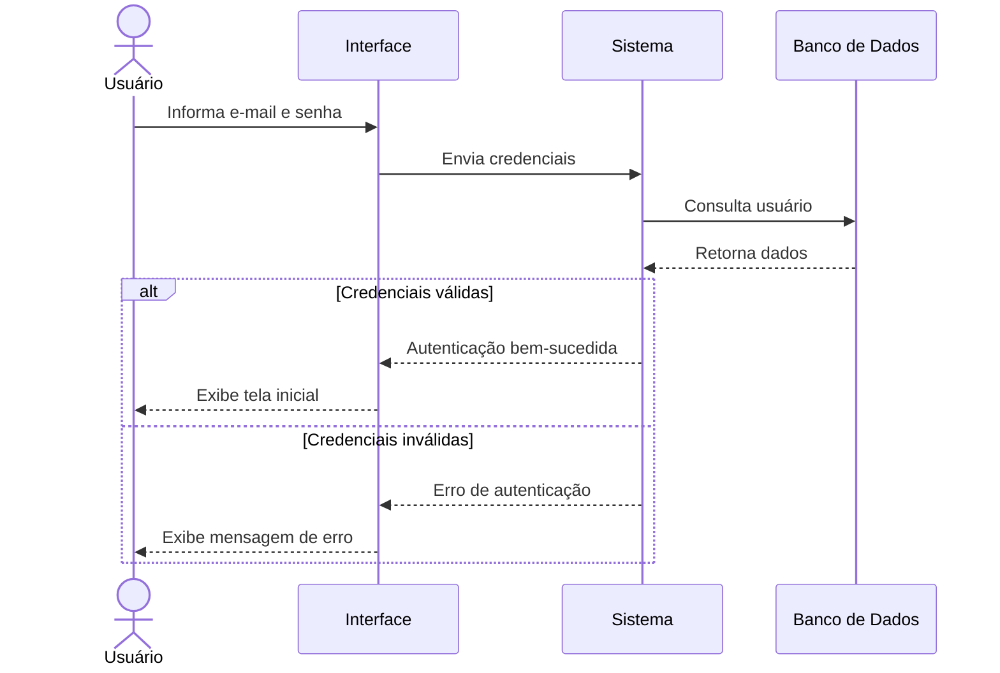
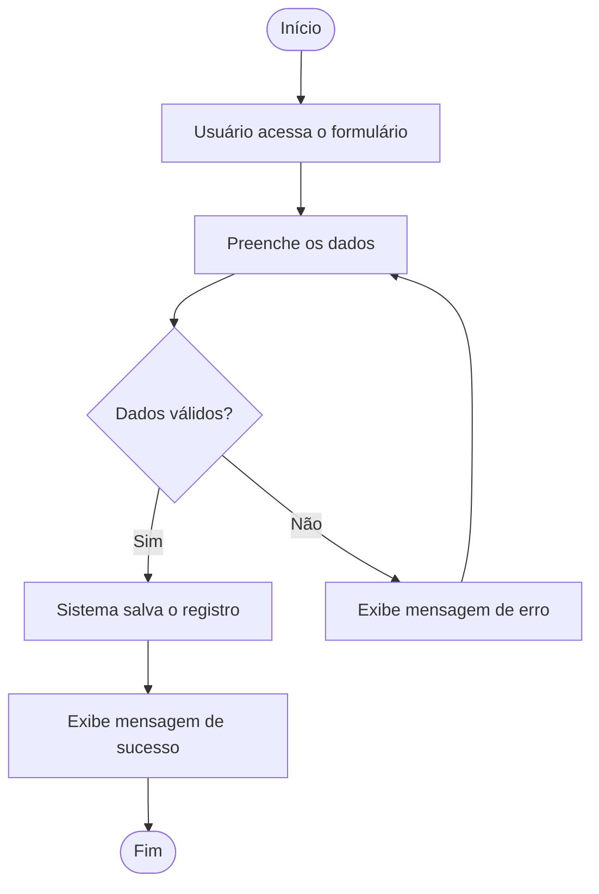

# [Nome do Software]

> [Slogan ou frase curta que resuma o software]

**Disciplina:** Gerência de Configuração
**Docente:** Walter Viana
**Equipe:** [Nome 1], [Nome 2], [Nome 3]

---

## Sumário

1. [Introdução](#1-introdução)
2. [Requisitos Gerais do Software](#2-requisitos-gerais-do-software)
3. [Diagramas UML](#3-diagramas-uml)

---

## 1. Introdução

### 1.1. Descrição Geral do Software

[Explique em um ou dois parágrafos o que o software faz, qual problema resolve, para quem foi criado e qual o contexto de uso.]

**Objetivos principais:**

- [Objetivo 1]
- [Objetivo 2]
- [Objetivo 3]

### 1.2. Descrição dos Usuários

| Perfil de usuário | Descrição | Principais responsabilidades |
|---|---|---|
| [Ex.: Administrador] | [Quem é e o que sabe fazer] | [O que faz no sistema] |
| [Ex.: Cliente] | [Quem é e o que sabe fazer] | [O que faz no sistema] |
| [Ex.: Atendente] | [Quem é e o que sabe fazer] | [O que faz no sistema] |

---

## 2. Requisitos Gerais do Software

### 2.1. Requisitos Funcionais

| ID | Requisito | Descrição | Prioridade |
|---|---|---|---|
| RF01 | [Nome] | O sistema deve permitir que [usuário] [ação]. | Alta |
| RF02 | [Nome] | O sistema deve permitir que [usuário] [ação]. | Média |
| RF03 | [Nome] | O sistema deve [ação]. | Baixa |

### 2.2. Requisitos Não Funcionais

| ID | Categoria | Descrição |
|---|---|---|
| RNF01 | Desempenho | [Ex.: O sistema deve responder às consultas em até 3 segundos.] |
| RNF02 | Usabilidade | [Ex.: A interface deve ser responsiva e funcionar em celulares.] |
| RNF03 | Segurança | [Ex.: As senhas devem ser armazenadas de forma criptografada.] |
| RNF04 | Disponibilidade | [Ex.: O sistema deve estar disponível 99% do tempo.] |
| RNF05 | Compatibilidade | [Ex.: Deve funcionar nos navegadores Chrome, Firefox e Edge.] |

### 2.3. Regras de Negócio

| ID | Regra | Descrição |
|---|---|---|
| RN01 | [Nome da regra] | [Ex.: Um usuário só pode ter um agendamento por horário.] |
| RN02 | [Nome da regra] | [Ex.: O cancelamento deve ocorrer com no mínimo 24h de antecedência.] |
| RN03 | [Nome da regra] | [Descrição] |

---

## 3. Diagramas UML

> Os diagramas abaixo usam **Mermaid**, que o GitHub renderiza automaticamente. Se preferir, substitua por imagens exportadas da sua ferramenta de modelagem usando ``.

### 3.1. Diagramas de Casos de Uso

```mermaid
flowchart LR
    U([Usuário])
    A([Administrador])

    subgraph Sistema["[Nome do Software]"]
        UC1(Realizar login)
        UC2(Cadastrar [entidade])
        UC3(Consultar [entidade])
        UC4(Gerenciar usuários)
    end

    U --> UC1
    U --> UC2
    U --> UC3
    A --> UC1
    A --> UC4
```

**Descrição dos casos de uso:**

| Caso de uso | Ator | Descrição |
|---|---|---|
| Realizar login | Usuário, Administrador | [Descrição] |
| Cadastrar [entidade] | Usuário | [Descrição] |

### 3.2. Diagramas de Sequência

**Sequência: [Nome do fluxo, ex.: Realizar login]**



### 3.3. Diagramas de Atividades

**Atividade: [Nome do processo, ex.: Cadastrar item]**



---

## Histórico de versões

| Versão | Data | Descrição | Autor |
|---|---|---|---|
| 1.0 | [DD/MM/AAAA] | Versão inicial da documentação | [Nome] |
