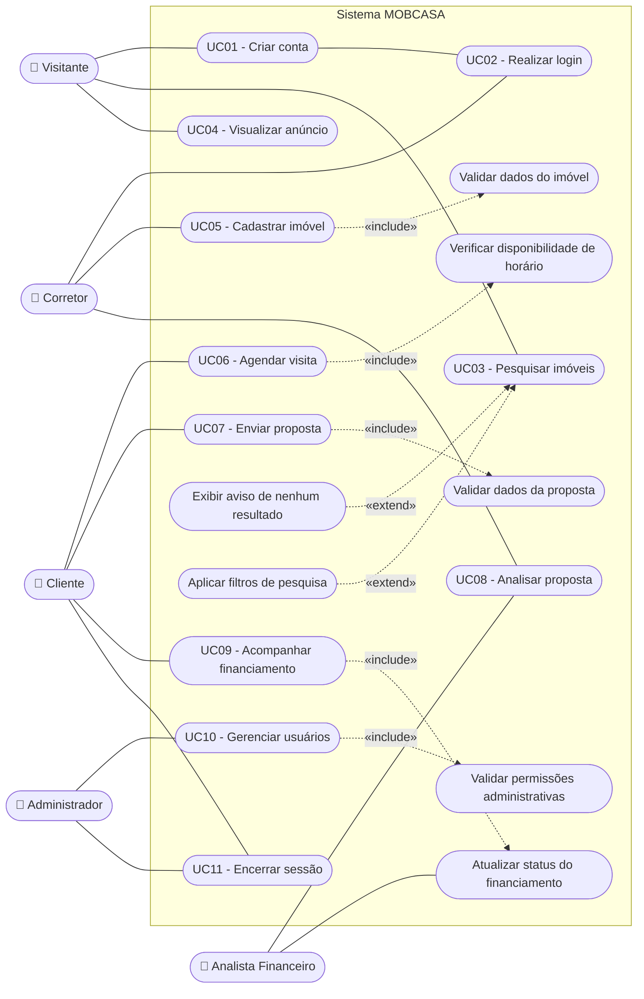
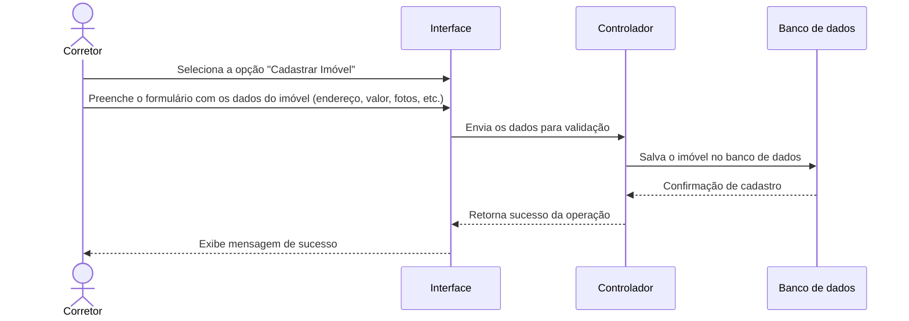
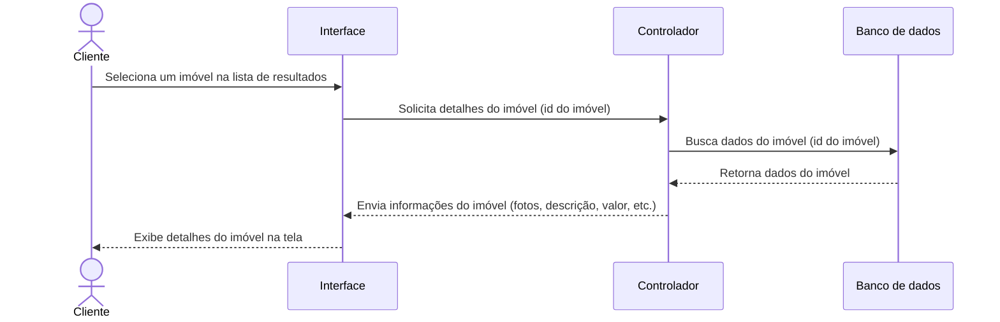
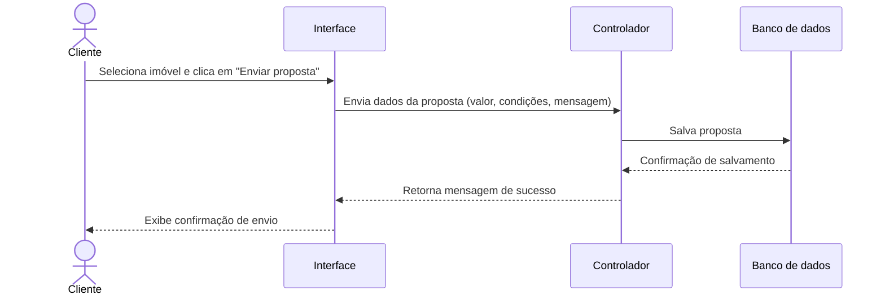
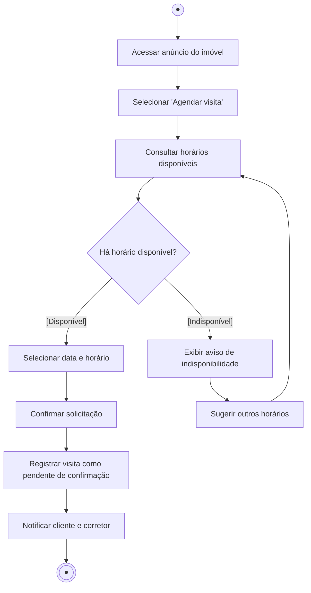

# 🏠 MOBCASA

> Plataforma web para divulgação de imóveis à venda e apoio às etapas iniciais de negociação.

**Universidade Federal do Amazonas (UFAM) – Instituto de Ciências Exatas e Tecnologia (ICET)**
**Curso:** Engenharia de Software · **Período:** 2026.2
**Disciplina:** Gerência de Configuração · **Docente:** Walter Viana

**Equipe:**
- Letícia Abreu
- Luís Gustavo
- Paolla Gabriele

---

## Sumário

1. [Introdução](#1-introdução)
   - 1.1. [Descrição Geral do Software](#11-descrição-geral-do-software)
   - 1.2. [Descrição dos Usuários](#12-descrição-dos-usuários)
2. [Requisitos Gerais do Software](#2-requisitos-gerais-do-software)
   - 2.1. [Requisitos Funcionais](#21-requisitos-funcionais)
   - 2.2. [Requisitos Não Funcionais](#22-requisitos-não-funcionais)
   - 2.3. [Regras de Negócio](#23-regras-de-negócio)
3. [Diagramas UML](#3-diagramas-uml)
   - 3.1. [Diagramas de Casos de Uso](#31-diagramas-de-casos-de-uso)
   - 3.2. [Diagramas de Sequência](#32-diagramas-de-sequência)
   - 3.3. [Diagramas de Atividades](#33-diagramas-de-atividades)

---

## 1. Introdução

### 1.1. Descrição Geral do Software

O **MOBCASA** é uma plataforma web que facilita a busca e a negociação de imóveis à venda. Ela é voltada à divulgação de anúncios e ao apoio das etapas iniciais da negociação, conectando quem deseja comprar um imóvel a quem o anuncia.

Na plataforma, visitantes podem pesquisar e visualizar anúncios. Após criar uma conta e fazer login, clientes podem agendar visitas, enviar propostas de compra e acompanhar o andamento de seus financiamentos. Corretores cadastram imóveis e analisam as propostas recebidas, analistas financeiros registram atualizações de financiamento e administradores gerenciam contas e permissões.

**Objetivos principais:**

- Divulgar imóveis à venda de forma clara, com fotos, preço, descrição e características.
- Facilitar a busca de imóveis por palavras-chave e filtros.
- Apoiar as etapas iniciais da negociação (visita, proposta e financiamento).
- Controlar o acesso às funcionalidades de acordo com o perfil de cada usuário.

### 1.2. Descrição dos Usuários

| Perfil | Descrição | Principais responsabilidades no sistema |
|---|---|---|
| **Visitante** | Pessoa que acessa a plataforma sem estar autenticada. | Criar conta, pesquisar imóveis e visualizar anúncios. |
| **Cliente** | Usuário autenticado interessado em comprar um imóvel. | Pesquisar e visualizar anúncios, agendar visitas, enviar propostas, acompanhar o financiamento e encerrar a sessão. |
| **Corretor** | Profissional responsável por anunciar e negociar os imóveis. | Cadastrar imóveis, analisar propostas recebidas (registrar resultado ou solicitar negociação) e encerrar a sessão. |
| **Analista Financeiro** | Profissional responsável pelo acompanhamento dos financiamentos. | Registrar atualizações no estado do financiamento e encerrar a sessão. |
| **Administrador** | Responsável pela gestão da plataforma. | Gerenciar contas de usuários e suas permissões e encerrar a sessão. |

---

## 2. Requisitos Gerais do Software

### 2.1. Requisitos Funcionais

| ID | Requisito | Descrição | Ator(es) |
|---|---|---|---|
| RF01 | Criar conta | O sistema deve permitir que o visitante crie uma conta informando os dados solicitados, validando as informações e verificando se não há conta duplicada. | Visitante |
| RF02 | Realizar login | O sistema deve permitir que o usuário acesse a plataforma com suas credenciais, iniciando a sessão e apresentando a área correspondente ao seu perfil. | Cliente, Corretor, Analista Financeiro, Administrador |
| RF03 | Pesquisar imóveis | O sistema deve permitir a busca de anúncios por palavras-chave e/ou filtros, exibindo os resultados encontrados ou um aviso caso não haja resultados. | Visitante, Cliente |
| RF04 | Visualizar anúncio | O sistema deve exibir os detalhes de um imóvel (fotos, preço, descrição, características e disponibilidade). | Visitante, Cliente |
| RF05 | Cadastrar imóvel | O sistema deve permitir que o corretor cadastre um imóvel informando seus dados e imagens, validando os campos obrigatórios antes de registrar o anúncio. | Corretor |
| RF06 | Agendar visita | O sistema deve permitir que o cliente solicite uma visita a um imóvel escolhendo data e horário disponíveis, registrando a solicitação como pendente de confirmação e notificando cliente e corretor. | Cliente |
| RF07 | Enviar proposta | O sistema deve permitir que o cliente envie uma proposta de compra informando valor e condições, registrando-a e informando seu identificador. | Cliente |
| RF08 | Analisar proposta | O sistema deve permitir que o corretor consulte as propostas recebidas, registre o resultado da análise ou solicite negociação, atualizando o estado e mantendo o histórico da alteração. | Corretor |
| RF09 | Acompanhar financiamento | O sistema deve permitir que o cliente consulte o andamento da sua solicitação de financiamento e que o analista financeiro autorizado registre novas atualizações. | Cliente, Analista Financeiro |
| RF10 | Gerenciar usuários | O sistema deve permitir que o administrador localize contas e altere seu estado ou suas permissões, registrando as alterações realizadas. | Administrador |
| RF11 | Encerrar sessão | O sistema deve permitir que o usuário encerre sua sessão, bloqueando o acesso às funcionalidades protegidas e redirecionando-o à página pública ou ao login. | Cliente, Corretor, Analista Financeiro, Administrador |

### 2.2. Requisitos Não Funcionais

| ID | Categoria | Descrição |
|---|---|---|
| RNF01 | Plataforma | O sistema deve ser uma aplicação web, acessível por meio de navegador com conexão à internet. |
| RNF02 | Segurança | O acesso às funcionalidades protegidas deve exigir autenticação, e cada perfil só pode acessar as funções permitidas a ele. |
| RNF03 | Segurança | As credenciais dos usuários devem ser armazenadas de forma protegida. |
| RNF04 | Rastreabilidade | O sistema deve manter histórico das alterações de estado de propostas e das alterações de contas e permissões. |
| RNF05 | Usabilidade | O sistema deve informar ao usuário, por mensagens claras, o resultado das operações e os motivos de erros ou bloqueios (ex.: campo inválido, horário indisponível, anúncio indisponível). |
| RNF06 | Usabilidade | A interface deve ser responsiva, adaptando-se a computadores e dispositivos móveis. |
| RNF07 | Desempenho | As pesquisas e a exibição de anúncios devem ocorrer em tempo adequado, mesmo com muitos anúncios publicados. |
| RNF08 | Confiabilidade | Os dados de imóveis, propostas, visitas e financiamentos devem ser persistidos de forma consistente em banco de dados. |

### 2.3. Regras de Negócio

| ID | Regra | Descrição |
|---|---|---|
| RN01 | Conta única | Não é permitido criar uma conta duplicada; campos inválidos ou conta já existente impedem a conclusão do cadastro. |
| RN02 | Conta ativa | Somente usuários com conta ativa e credenciais válidas podem fazer login. |
| RN03 | Acesso por perfil | Após o login, o usuário acessa apenas a área e as funções permitidas ao seu perfil. |
| RN04 | Cadastro de imóvel | Somente corretores autenticados e autorizados podem cadastrar imóveis; campos obrigatórios ausentes ou dados inconsistentes impedem o cadastro. |
| RN05 | Pesquisa | Filtros inválidos devem ser corrigidos ou ignorados com mensagem clara, e uma pesquisa sem resultados deve gerar aviso. |
| RN06 | Anúncio indisponível | Anúncio removido ou indisponível não exibe seus detalhes e gera mensagem adequada. |
| RN07 | Agendamento de visita | Somente clientes autenticados podem agendar visitas, e apenas em anúncios disponíveis para visita. |
| RN08 | Horário disponível | Horário indisponível ou dados inválidos impedem o envio da solicitação, e o sistema deve sugerir nova seleção quando possível. |
| RN09 | Estado da visita | Toda solicitação de visita é registrada como pendente de confirmação. |
| RN10 | Envio de proposta | Somente clientes autenticados podem enviar propostas, e apenas para imóveis que aceitam propostas; caso contrário, o envio é bloqueado. |
| RN11 | Análise de proposta | Somente usuários autorizados podem alterar o estado de uma proposta, e toda alteração deve ser registrada no histórico. |
| RN12 | Financiamento | A plataforma não deve indicar aprovação de financiamento antes da decisão formal da instituição financeira. |
| RN13 | Atualização de financiamento | Somente o analista financeiro autorizado pode registrar atualizações no estado do financiamento. |
| RN14 | Gestão de usuários | Somente administradores, com privilégio administrativo, podem alterar contas e permissões. |
| RN15 | Encerramento de sessão | Após encerrar a sessão, as funcionalidades protegidas exigem nova autenticação. |

---

## 3. Diagramas UML

> Os diagramas abaixo foram escritos em **Mermaid**, que o GitHub renderiza automaticamente. Eles reproduzem os diagramas elaborados no trabalho de modelagem do MOBCASA.

### 3.1. Diagramas de Casos de Uso

**Diagrama de Casos de Uso – Sistema MOBCASA**

**Especificação resumida dos casos de uso:**

| ID | Caso de uso | Ator principal | Resumo | Pré-condições | Pós-condições |
|---|---|---|---|---|---|
| UC01 | Criar conta | Cliente/Visitante | O usuário cria uma conta para acessar as funcionalidades autenticadas. | Não possui sessão ativa e tem acesso à internet. | Conta criada e usuário pode realizar login. |
| UC02 | Realizar login | Cliente, Corretor, Analista Financeiro, Administrador | O usuário entra no sistema com suas credenciais. | Possui uma conta ativa. | Sessão autenticada e acesso às funções permitidas ao perfil. |
| UC03 | Pesquisar imóveis | Visitante/Cliente | O usuário procura anúncios por critérios de interesse. | Existem anúncios publicados ou a pesquisa pode retornar vazia. | Lista de resultados ou aviso de que não há resultados. |
| UC04 | Visualizar anúncio | Visitante/Cliente | O usuário consulta os detalhes de um imóvel anunciado. | O anúncio existe e está visível publicamente. | Detalhes do anúncio apresentados. |
| UC05 | Cadastrar imóvel | Corretor | O corretor publica um novo imóvel para venda. | Corretor autenticado e autorizado. | Anúncio registrado como disponível ou aguardando publicação. |
| UC06 | Agendar visita | Cliente | O cliente solicita uma visita ao imóvel. | Cliente autenticado e anúncio disponível para visita. | Solicitação registrada como pendente de confirmação. |
| UC07 | Enviar proposta | Cliente | O cliente registra uma oferta de compra. | Cliente autenticado e imóvel aceita propostas. | Proposta registrada e disponível para análise comercial. |
| UC08 | Analisar proposta | Corretor | O corretor consulta e atualiza o estado comercial de uma proposta. | Corretor autenticado e autorizado a tratar a proposta. | Proposta atualizada e cliente pode acompanhar o estado. |
| UC09 | Acompanhar financiamento | Cliente/Analista Financeiro | O cliente consulta o andamento e o analista autorizado registra atualizações. | Solicitação registrada e usuário com permissão adequada. | Estado atualizado disponível aos usuários autorizados. |
| UC10 | Gerenciar usuários | Administrador | O administrador controla contas e permissões. | Administrador autenticado com privilégio administrativo. | Alterações de conta e permissões registradas. |
| UC11 | Encerrar sessão | Cliente/Corretor/Analista Financeiro/Administrador | O usuário encerra seu acesso autenticado. | Existe sessão ativa. | Sessão encerrada e acesso protegido bloqueado. |

### 3.2. Diagramas de Sequência

#### 3.2.1. Cadastrar imóvel

#### 3.2.2. Visualizar imóvel

#### 3.2.3. Enviar proposta

### 3.3. Diagramas de Atividades

#### 3.3.1. Agendar visita

---

## Referências

- UNIVERSIDADE FEDERAL DO AMAZONAS. Instituto de Ciências Exatas e Tecnologia. *Documentação de Requisitos (normas, tipos, audiência, estrutura)*. Material didático da disciplina, docente Walter Viana.
- UNIVERSIDADE FEDERAL DO AMAZONAS. Instituto de Ciências Exatas e Tecnologia. *Sintaxe de Caso de Uso*. Material didático da disciplina, docente Walter Viana.
- SOMMERVILLE, Ian. *Engenharia de Software*. 10. ed. São Paulo: Pearson, 2019.
- PRESSMAN, Roger S.; MAXIM, Bruce R. *Engenharia de Software: uma abordagem profissional*. 9. ed. Porto Alegre: AMGH, 2021.
